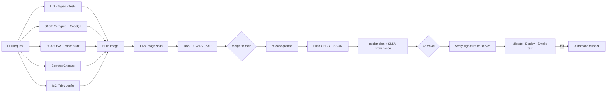
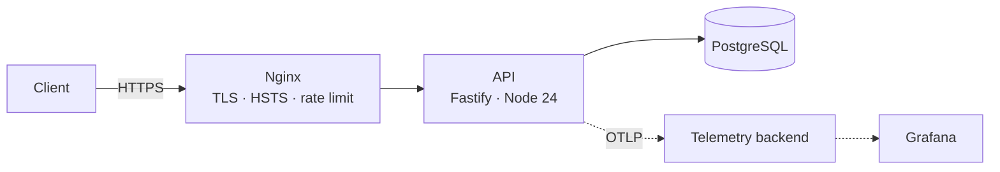

<h1 align="center">secure-api-pipeline</h1>

<p align="center">
  <b>A production-grade Node.js/TypeScript API and the DevSecOps pipeline around it — from secure code to signed, verified and observable deployments.</b>
</p>

<p align="center">
  <a href="https://github.com/caiodassumpcao/secure-api-pipeline/actions/workflows/ci.yml"></a>
  <a href="https://github.com/caiodassumpcao/secure-api-pipeline/actions/workflows/security.yml"></a>
  <a href="https://scorecard.dev/viewer/?uri=github.com/caiodassumpcao/secure-api-pipeline"></a>
  
  <a href="LICENSE"></a>
</p>

---

## Why

Security is usually a checklist at the end. Here it is the **pipeline itself**: every pull request is linted, tested, scanned for vulnerable code, dependencies, secrets and misconfigurations, attacked by a DAST scanner, built into a minimal non-root image, scanned again, documented with an SBOM, **signed**, given **build provenance** — and only a verified image can reach production, with automatic rollback if it misbehaves.

The API is a small multi-tenant project & task tracker. Small on purpose: the focus is on how it is built, secured, shipped and operated.

## Highlights

|                             |                                                                                                                     |
| --------------------------- | ------------------------------------------------------------------------------------------------------------------- |
| 🔐 **Secure by default**    | argon2id passwords, short-lived EdDSA JWTs, rotating refresh tokens with reuse detection, lockout and rate limiting |
| 🏢 **Tenant isolation**     | Role-based permissions per workspace, enforced at the data layer and tested for every role × action                 |
| 🧪 **Tested**               | Unit, integration (real PostgreSQL via Testcontainers), security and DAST suites; ≥ 85 % coverage gate              |
| 🛡️ **DevSecOps pipeline**   | Semgrep, CodeQL, Gitleaks, OSV-Scanner, Trivy, OWASP ZAP — all reported to GitHub code scanning                     |
| 📦 **Supply chain**         | Distroless non-root image, SBOM (SPDX + CycloneDX), cosign keyless signatures, SLSA build provenance                |
| 🚀 **Verified deploys**     | Signature checked on the server, migrations, smoke tests, automatic rollback                                        |
| 📈 **Observable**           | OpenTelemetry traces and metrics, logs correlated by `trace_id`                                                     |
| 🧭 **Documented decisions** | Threat model (STRIDE), ADRs, runbook                                                                                |

## Pipeline



Details of every gate and what it catches: [`docs/security-pipeline.md`](docs/security-pipeline.md).

## Architecture



| Layer         | Stack                                                        |
| ------------- | ------------------------------------------------------------ |
| Runtime       | Node.js 24 LTS · TypeScript (strict)                         |
| HTTP          | Fastify 5 · zod (validation + OpenAPI)                       |
| Data          | PostgreSQL 17 · Drizzle ORM · SQL migrations                 |
| Auth          | argon2id · `jose` (Ed25519 JWT) · rotating refresh tokens    |
| Observability | OpenTelemetry · pino · Prometheus metrics                    |
| Delivery      | Docker (distroless) · GitHub Actions · GHCR · cosign · Nginx |

## Quick start

Requirements: Docker + Compose v2. For development without Docker: Node 24 and pnpm (`corepack enable`).

```bash
git clone https://github.com/caiodassumpcao/secure-api-pipeline.git
cd secure-api-pipeline
cp .env.example .env
pnpm keys:generate                 # dev Ed25519 key pair
docker compose up -d               # api + postgres (migrations run automatically)
curl localhost:3000/health/ready
open http://localhost:3000/docs    # OpenAPI UI
```

With local observability (Grafana, Prometheus, Tempo, Loki):

```bash
docker compose --profile observability up -d
open http://localhost:3001         # Grafana
```

### Try it

```bash
# Register and log in
curl -s localhost:3000/v1/auth/register -H 'content-type: application/json' \
  -d '{"email":"ana@example.com","password":"correct-horse-battery-staple","name":"Ana"}'

TOKEN=$(curl -s -c cookies.txt localhost:3000/v1/auth/login -H 'content-type: application/json' \
  -d '{"email":"ana@example.com","password":"correct-horse-battery-staple"}' | jq -r .accessToken)

curl -s localhost:3000/v1/me -H "authorization: Bearer $TOKEN"
```

## API overview

| Resource   | Endpoints                                                                               |
| ---------- | --------------------------------------------------------------------------------------- |
| Auth       | `POST /v1/auth/register` · `login` · `refresh` · `logout`                               |
| Me         | `GET /v1/me`                                                                            |
| Workspaces | `/v1/workspaces[/:wsId]`                                                                |
| Members    | `/v1/workspaces/:wsId/members[/:userId]`                                                |
| Projects   | `/v1/workspaces/:wsId/projects[/:projectId]`                                            |
| Tasks      | `/v1/workspaces/:wsId/projects/:projectId/tasks` · `/v1/workspaces/:wsId/tasks/:taskId` |
| Audit      | `GET /v1/workspaces/:wsId/audit-events`                                                 |
| Health     | `/health/live` · `/health/ready`                                                        |

Errors use [RFC 9457](https://www.rfc-editor.org/rfc/rfc9457) problem details and always include a `traceId`.

### Roles

| Action                | owner | admin | member | viewer |
| --------------------- | :---: | :---: | :----: | :----: |
| Read projects & tasks |  ✅   |  ✅   |   ✅   |   ✅   |
| Create / update tasks |  ✅   |  ✅   |   ✅   |   —    |
| Manage projects       |  ✅   |  ✅   |   —    |   —    |
| Manage members        |  ✅   |  ✅   |   —    |   —    |
| Read audit log        |  ✅   |  ✅   |   —    |   —    |
| Delete workspace      |  ✅   |   —   |   —    |   —    |

## Verify a release image

```bash
IMAGE=ghcr.io/caiodassumpcao/secure-api-pipeline:1.0.0

cosign verify "$IMAGE" \
  --certificate-identity-regexp '^https://github.com/caiodassumpcao/secure-api-pipeline/' \
  --certificate-oidc-issuer https://token.actions.githubusercontent.com

gh attestation verify "oci://$IMAGE" --owner caiodassumpcao
```

## Security

- Threat model: [`docs/threat-model.md`](docs/threat-model.md)
- Security pipeline: [`docs/security-pipeline.md`](docs/security-pipeline.md)
- Reporting a vulnerability: [`SECURITY.md`](SECURITY.md)

## Part of a platform

| Repository                                                                     | Role                                           |
| ------------------------------------------------------------------------------ | ---------------------------------------------- |
| [server-hardening-kit](https://github.com/caiodassumpcao/server-hardening-kit) | Hardens the server this API runs on            |
| **secure-api-pipeline**                                                        | Builds, secures and ships the API              |
| [drkit](https://github.com/caiodassumpcao/drkit)                               | Backs up and recovers it                       |
| observability-stack _(coming soon)_                                            | Monitors it: metrics, logs, traces, SLO alerts |

## Roadmap

- [ ] Foundation — tooling, config, health, CI
- [ ] **v0.1** — Domain, data model, CRUD, OpenAPI
- [ ] **v0.2** — Authentication, authorization, tenant isolation, audit log, threat model
- [ ] **v0.3** — OpenTelemetry traces, metrics and correlated logs
- [ ] **v0.4** — DevSecOps pipeline: scanners, SBOM, signing, provenance, DAST
- [ ] **v1.0** — Verified deploys with automatic rollback

## Documentation

- [Design specification](docs/DESIGN.md)
- [Architecture decision records](docs/adr/)
- [Runbook](docs/runbook.md)

## Development

```bash
corepack enable && pnpm install
pnpm dev               # watch mode
pnpm test              # unit
pnpm test:integration  # needs Docker
pnpm lint && pnpm typecheck
```

See [CONTRIBUTING.md](CONTRIBUTING.md).

## License

[MIT](LICENSE) © Caio Dassumpção Rodrigues
