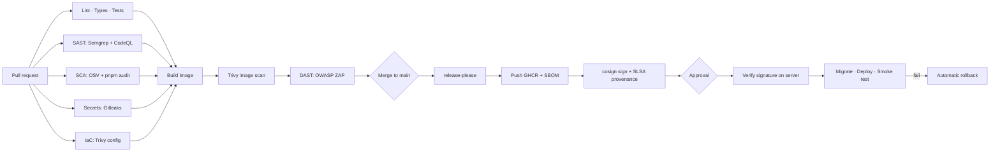
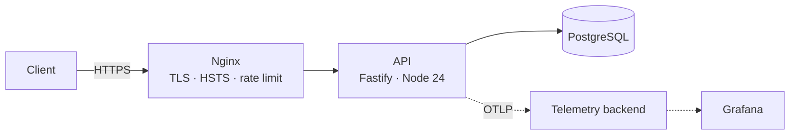

<h1 align="center">secure-api-pipeline</h1>

<p align="center">
  <b>A production-grade Node.js/TypeScript API and the DevSecOps pipeline around it — from secure code to signed, verified and observable deployments.</b>
</p>

<p align="center">
  <a href="https://github.com/caiodassumpcao/secure-api-pipeline/actions/workflows/ci.yml"></a>
  <!-- v0.4: security workflow and OpenSSF Scorecard badges
  <a href="https://github.com/caiodassumpcao/secure-api-pipeline/actions/workflows/security.yml"></a>
  <a href="https://scorecard.dev/viewer/?uri=github.com/caiodassumpcao/secure-api-pipeline"></a>
  -->
  
  <a href="LICENSE"></a>
</p>

> [!NOTE]
> **Built in public, phase by phase.** v0.3 makes the API observable: OpenTelemetry traces from each request down to its SQL queries, RED and security metrics, and logs correlated by trace id, with a local Grafana. It builds on v0.2 (Ed25519 access tokens with rotating refresh tokens, brute-force protection, an append-only audit log, member invitations) and v0.1 (tenant-isolated workspaces, projects and tasks, migrations and OpenAPI docs). Highlights and Architecture describe the v1.0 target; sections marked with a version describe what that release delivers — see the [roadmap](#roadmap).

---

## Why

Security is usually a checklist at the end. Here it is the **pipeline itself**: every pull request is linted, tested, scanned for vulnerable code, dependencies, secrets and misconfigurations, attacked by a DAST scanner, built into a minimal non-root image, scanned again, documented with an SBOM, **signed**, given **build provenance** — and only a verified image can reach production, with automatic rollback if it misbehaves.

The API is a small multi-tenant project & task tracker. Small on purpose: the focus is on how it is built, secured, shipped and operated.

## Highlights

|                             |                                                                                                                     |
| --------------------------- | ------------------------------------------------------------------------------------------------------------------- |
| 🔐 **Secure by default**    | argon2id passwords, short-lived EdDSA JWTs, rotating refresh tokens with reuse detection, lockout and rate limiting |
| 🏢 **Tenant isolation**     | Role-based permissions per workspace, enforced at the data layer and tested for every role × action                 |
| 🧪 **Tested**               | Unit, integration (real PostgreSQL via Testcontainers), security and DAST suites; ≥ 85 % coverage gate              |
| 🛡️ **DevSecOps pipeline**   | Semgrep, CodeQL, Gitleaks, OSV-Scanner, Trivy, OWASP ZAP — all reported to GitHub code scanning                     |
| 📦 **Supply chain**         | Distroless non-root image, SBOM (SPDX + CycloneDX), cosign keyless signatures, SLSA build provenance                |
| 🚀 **Verified deploys**     | Signature checked on the server, migrations, smoke tests, automatic rollback                                        |
| 📈 **Observable**           | OpenTelemetry traces (HTTP → service → SQL), RED and security metrics, logs correlated by `trace_id`, no secrets    |
| 🧭 **Documented decisions** | Threat model (STRIDE), ADRs, runbook                                                                                |

## Pipeline



Details of every gate and what it catches: `docs/security-pipeline.md` _(v0.4)_.

## Architecture



| Layer         | Stack                                                        |
| ------------- | ------------------------------------------------------------ |
| Runtime       | Node.js 24 LTS · TypeScript (strict)                         |
| HTTP          | Fastify 5 · zod (validation + OpenAPI)                       |
| Data          | PostgreSQL 17 · Drizzle ORM · SQL migrations                 |
| Auth          | argon2id · `jose` (Ed25519 JWT) · rotating refresh tokens    |
| Observability | OpenTelemetry · pino · Prometheus metrics                    |
| Delivery      | Docker (distroless) · GitHub Actions · GHCR · cosign · Nginx |

## Quick start

Requirements: Docker + Compose v2. For development without Docker: Node 24 and pnpm (`corepack enable`).

```bash
git clone https://github.com/caiodassumpcao/secure-api-pipeline.git
cd secure-api-pipeline
cp .env.example .env                 # local development values
pnpm keys:generate                   # Ed25519 key pair for access tokens, in keys/ (git-ignored)
docker compose up -d --build --wait  # postgres, one-shot migrate, api; ports bound to 127.0.0.1
curl localhost:3000/health/ready     # {"status":"ok","checks":{"database":"ok","migrations":"ok"}}
open http://localhost:3000/docs      # OpenAPI UI (document at /openapi.json)
```

The `migrate` service applies the SQL migrations and exits; the API starts only if it succeeded, and `/health/ready` stays 503 until the database has the schema the build expects. The signing keys reach the API as Compose secrets. Without Node, create them with OpenSSL instead of `pnpm keys:generate`:

```bash
mkdir -p keys && openssl genpkey -algorithm ed25519 -out keys/jwt-private.pem
openssl pkey -in keys/jwt-private.pem -pubout -out keys/jwt-public.pem
```

The container runs as uid 65532 (distroless `nonroot`): on Linux, make the development private key readable by it (`chmod 644 keys/jwt-private.pem`); `pnpm keys:generate` writes it for your user only.

With local observability (Grafana, Tempo, Loki, Prometheus and a provisioned dashboard):

```bash
API_OTLP_ENDPOINT=http://otel-lgtm:4318 docker compose --profile observability up -d --build --wait
open http://localhost:3001         # Grafana: Dashboards → secure-api-pipeline → secure-api
```

What to look at, from a trace of one request to the log lines it wrote: [`docs/observability.md`](docs/observability.md).

### Try it

```bash
# Register (a personal workspace comes with the account) and log in
curl -s localhost:3000/v1/auth/register -H 'content-type: application/json' \
  -d '{"email":"ana@example.com","password":"correct-horse-battery-staple","name":"Ana"}'

TOKEN=$(curl -s -c cookies.txt localhost:3000/v1/auth/login -H 'content-type: application/json' \
  -d '{"email":"ana@example.com","password":"correct-horse-battery-staple"}' | jq -r .accessToken)

curl -s localhost:3000/v1/me -H "authorization: Bearer $TOKEN"

# 15 minutes later: a new access token from the refresh cookie, which rotates
TOKEN=$(curl -s -b cookies.txt -c cookies.txt -X POST localhost:3000/v1/auth/refresh | jq -r .accessToken)

# Invite someone: share the single-use token, they accept it once logged in
WORKSPACE_ID=$(curl -s localhost:3000/v1/me -H "authorization: Bearer $TOKEN" | jq -r '.memberships[0].workspaceId')
curl -s localhost:3000/v1/workspaces/$WORKSPACE_ID/invitations -H "authorization: Bearer $TOKEN" \
  -H 'content-type: application/json' -d '{"role":"member"}'
```

## API overview

Every `/v1` route but registration, login, refresh and logout takes an access token (`Authorization: Bearer`). The full reference is the OpenAPI document served at `/docs`.

| Resource    | Endpoints                                                                               |
| ----------- | --------------------------------------------------------------------------------------- |
| Auth        | `POST /v1/auth/register` · `login` · `refresh` · `logout`                               |
| Me          | `GET /v1/me`                                                                            |
| Workspaces  | `/v1/workspaces[/:wsId]`                                                                |
| Members     | `/v1/workspaces/:wsId/members[/:userId]` (read, change role, remove)                    |
| Invitations | `/v1/workspaces/:wsId/invitations[/:invitationId]` · `POST /v1/invitations/accept`      |
| Projects    | `/v1/workspaces/:wsId/projects[/:projectId]` (`DELETE` archives)                        |
| Tasks       | `/v1/workspaces/:wsId/projects/:projectId/tasks` · `/v1/workspaces/:wsId/tasks/:taskId` |
| Audit       | `GET /v1/workspaces/:wsId/audit-events`                                                 |
| Health      | `/health/live` · `/health/ready`                                                        |

Lists use cursor pagination (`?limit=` 1–100 and the opaque `nextCursor`); task lists filter by `status`, `priority` and `assigneeId`. Errors use [RFC 9457](https://www.rfc-editor.org/rfc/rfc9457) problem details and always include a `traceId` — see the [problem types](docs/problems.md).

### Roles

| Action                               | owner |      admin      |  member  | viewer |
| ------------------------------------ | :---: | :-------------: | :------: | :----: |
| Read workspace, members              |  ✅   |       ✅        |    ✅    |   ✅   |
| Read projects & tasks                |  ✅   |       ✅        |    ✅    |   ✅   |
| Create / update tasks                |  ✅   |       ✅        |    ✅    |   —    |
| Delete tasks                         |  ✅   |       ✅        | own only |   —    |
| Manage projects, edit workspace      |  ✅   |       ✅        |    —     |   —    |
| Manage members, invitations          |  ✅   | ✅ (not owners) |    —     |   —    |
| Read audit log                       |  ✅   |       ✅        |    —     |   —    |
| Delete workspace, transfer ownership |  ✅   |        —        |    —     |   —    |

Callers outside a workspace get 404 for everything in it, as if it did not exist. Every role × action is tested over HTTP with real access tokens ([ADR-0005](docs/adr/0005-tenant-isolation-at-repository-layer.md)).

## Verify a release image

_Available from v0.4._

```bash
IMAGE=ghcr.io/caiodassumpcao/secure-api-pipeline:1.0.0

cosign verify "$IMAGE" \
  --certificate-identity-regexp '^https://github.com/caiodassumpcao/secure-api-pipeline/' \
  --certificate-oidc-issuer https://token.actions.githubusercontent.com

gh attestation verify "oci://$IMAGE" --owner caiodassumpcao
```

## Security

- Reporting a vulnerability: [`SECURITY.md`](SECURITY.md)
- Security design and controls: [`docs/DESIGN.md` §5](docs/DESIGN.md#5-security-design)
- Threat model: [`docs/threat-model.md`](docs/threat-model.md) — data flows, STRIDE per component, personal data and retention, residual risks
- Authentication: [ADR-0004](docs/adr/0004-token-strategy.md) tokens · [ADR-0009](docs/adr/0009-brute-force-protection.md) brute force · [ADR-0010](docs/adr/0010-member-invitations.md) invitations
- Telemetry without secrets: [ADR-0006](docs/adr/0006-opentelemetry-telemetry.md)
- Security pipeline: `docs/security-pipeline.md` _(v0.4)_

## Part of a platform

| Repository                                                                     | Role                                           |
| ------------------------------------------------------------------------------ | ---------------------------------------------- |
| [server-hardening-kit](https://github.com/caiodassumpcao/server-hardening-kit) | Hardens the server this API runs on            |
| **secure-api-pipeline**                                                        | Builds, secures and ships the API              |
| [drkit](https://github.com/caiodassumpcao/drkit)                               | Backs up and recovers it                       |
| observability-stack _(coming soon)_                                            | Monitors it: metrics, logs, traces, SLO alerts |

## Roadmap

- [x] Foundation — tooling, config, health, CI
- [x] **v0.1** — Domain, data model, CRUD, tenant isolation, OpenAPI
- [x] **v0.2** — Authentication, brute-force protection, audit log, invitations, threat model
- [x] **v0.3** — OpenTelemetry traces, metrics and correlated logs, local Grafana
- [ ] **v0.4** — DevSecOps pipeline: scanners, SBOM, signing, provenance, DAST
- [ ] **v1.0** — Verified deploys with automatic rollback

## Documentation

- [Design specification](docs/DESIGN.md)
- [Architecture decision records](docs/adr/)
- [Problem types](docs/problems.md)
- [Threat model](docs/threat-model.md)
- [Observability guide](docs/observability.md)
- [Contributing](CONTRIBUTING.md)
- Runbook — `docs/runbook.md` _(v1.0)_

## Development

```bash
corepack enable && pnpm install   # also installs the git hooks
cp .env.example .env
pnpm keys:generate                # development signing keys (keys/, git-ignored)
docker compose up -d postgres     # database for local development
pnpm db:migrate                   # apply the SQL migrations to DATABASE_URL
pnpm dev                          # watch mode, http://localhost:3000 (docs at /docs)
pnpm lint && pnpm typecheck
pnpm test                         # unit tests, no Docker needed
pnpm test:integration             # integration and security suites (PostgreSQL via Testcontainers)
pnpm test:coverage                # every suite, with the 85 % coverage gate
pnpm smoke:observability          # traces, logs, metrics and dashboard in the local Grafana
pnpm build                        # compile to dist/
```

Schema changes: edit `src/db/schema.ts`, run `pnpm db:generate` to write the SQL migration to `drizzle/`, then review and commit it ([ADR-0002](docs/adr/0002-drizzle-orm-with-reviewed-sql-migrations.md)).

See [CONTRIBUTING.md](CONTRIBUTING.md).

## License

[MIT](LICENSE) © Caio Dassumpção Rodrigues
