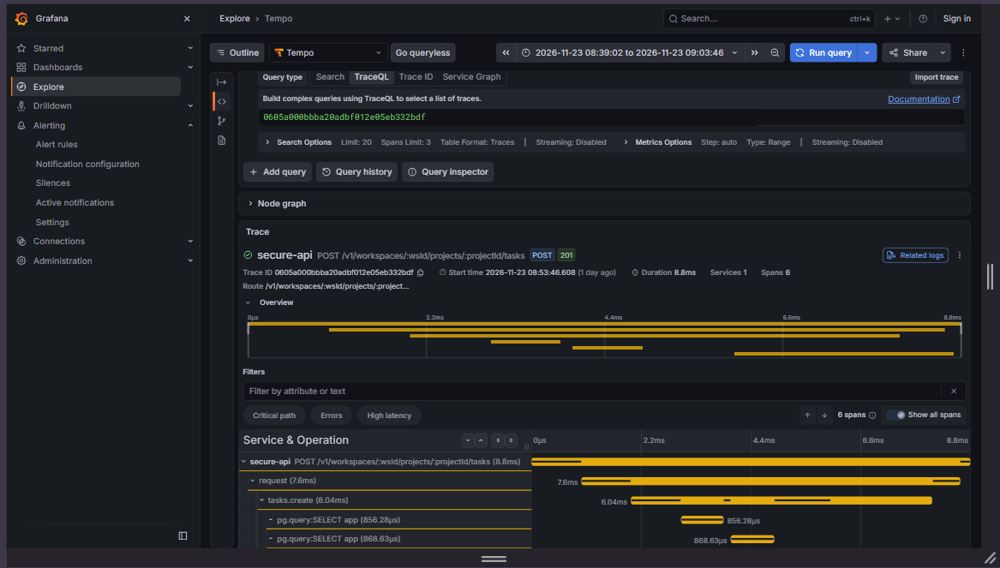
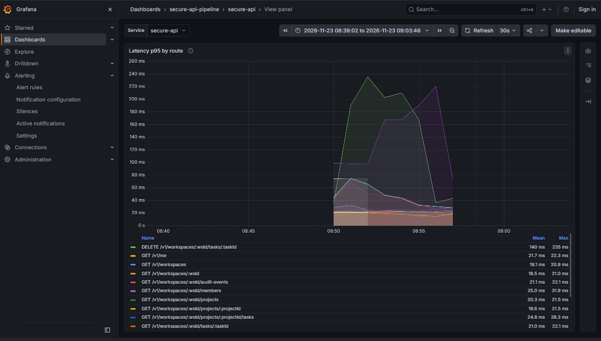
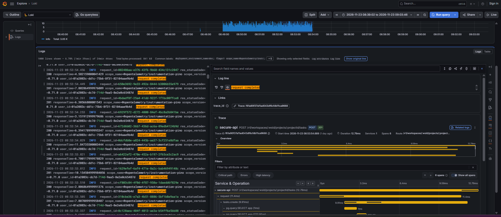

# Observability

The API emits OpenTelemetry traces, metrics and logs correlated by trace id ([DESIGN §6](DESIGN.md#6-observability), [ADR-0006](adr/0006-opentelemetry-telemetry.md)). This guide runs them locally in Grafana and shows what to look at.

## Run it locally

The Compose profile `observability` adds [`grafana/otel-lgtm`](https://github.com/grafana/docker-otel-lgtm): Grafana, Tempo (traces), Loki (logs) and Prometheus (metrics) behind one OTLP endpoint, for development only.

**Everything in containers**: uncomment the two observability lines of `.env` (from `.env.example`), then start the stack:

```bash
# .env
COMPOSE_PROFILES=observability
API_OTLP_ENDPOINT=http://otel-lgtm:4318

docker compose up -d --build --wait
```

**`pnpm dev` on the host**, exporting to the container:

```bash
docker compose --profile observability up -d postgres otel-lgtm
OTEL_EXPORTER_OTLP_ENDPOINT=http://localhost:4318 pnpm dev   # or set it in .env
```

Then open Grafana at <http://localhost:3001> (no login: anonymous visitors are admins, which is why every port is bound to `127.0.0.1`). The dashboard is under **Dashboards → secure-api-pipeline → secure-api**.

- `.env.example` keeps every trace (`OTEL_TRACES_SAMPLER_ARG=1.0`); without it the API keeps one in ten, the production default.
- Metrics are pushed every 60 seconds by default; `OTEL_METRIC_EXPORT_INTERVAL=10000` makes the dashboard livelier.
- Traces reach Tempo some 20 seconds after the request.
- Data lives in the container: `docker compose down` deletes it.
- With the profile on, the API starts once `otel-lgtm` is healthy (some 20 seconds), so no telemetry is pushed into a half-started stack.
- `ENABLE_LOGS_LOKI=true` and `ENABLE_LOGS_OTELCOL=true` in `.env` print the logs of Loki and of the collector, silenced by default.

`pnpm smoke:observability` sends traffic and checks every signal end to end, as the `observability` CI job does (`SMOKE_API_URL` if the API is not on port 3000). While it waits for Tempo and Loki it keeps creating a task every 5 seconds, and the trace and the log line it checks belong to the same request. On a Loki timeout it prints the last response and the collector's counters of log records received and sent, which tell whether the records stopped at the API, the collector or Loki. In CI, a failed run keeps the Compose logs, with tokens and cookies masked, as an artifact for 3 days.

## What to look at

### A request from end to end

In **Explore → Tempo**, search with TraceQL:

```text
{ resource.service.name = "secure-api" && span.http.route = "/v1/workspaces/:wsId/projects/:projectId/tasks" }
```

A trace has the HTTP server span, named after the route template, the Fastify request span with `request.id`, `user.id` and `workspace.id`, the service span (`tasks.create`) and one span per query, with the parameterized SQL and never its values.

Every error response carries the request id as `traceId` (and in the `x-request-id` header): `{ span.request.id = "<traceId>" }` finds its trace.



### Latency by route

The **secure-api** dashboard shows request rate, status codes, p95 latency and server-error ratio by route, failed logins by reason, refresh-token reuse, tasks created, the connection pool, query latency and the event loop. Labels are route templates, never raw URLs.



### From a log line to its trace

In **Explore → Loki**, query the API's logs:

```text
{service_name="secure-api"} | trace_id != ""
```

Expand a line: its `trace_id` field links to the trace in Tempo. The other way, a span's **Logs for this span** opens the lines it wrote. Logs reach Loki over OTLP only; collecting the container's stdout as well would show every line twice.



## Screenshots

Three screens illustrate this guide. Capture them from a local run with synthetic data only (`pnpm smoke:observability` and the README's _Try it_ use `example.test` and `example.com` addresses), all in the same Grafana theme, and save them as PNG:

| Screen                       | What it must show                                                                                                                                                                     | File                                         |
| ---------------------------- | ------------------------------------------------------------------------------------------------------------------------------------------------------------------------------------- | -------------------------------------------- |
| Trace HTTP → service → pg    | Explore → Tempo, a trace of `POST /v1/workspaces/:wsId/projects/:projectId/tasks` with the whole waterfall visible: the HTTP span, `request`, `tasks.create` and its `pg.query` spans | `docs/images/observability/trace.png`        |
| Latency by route             | The **Latency p95 by route** panel of the secure-api dashboard in view mode (`v`), over a fixed time range that covers the traffic, with several routes in the legend                 | `docs/images/observability/latency.png`      |
| From a log line to its trace | Explore → Loki with the query above, a `request completed` line expanded with its `trace_id` link to Tempo and the trace embedded in the log details (Grafana 13)                     | `docs/images/observability/log-to-trace.png` |

Some traffic for the latency panel, with the token from the README's _Try it_:

```bash
for i in $(seq 1 200); do
  curl -s -o /dev/null localhost:3000/v1/me -H "authorization: Bearer $TOKEN"
  curl -s -o /dev/null localhost:3000/v1/workspaces -H "authorization: Bearer $TOKEN"
done
pnpm smoke:observability
```

## Metric names

Prometheus appends unit suffixes to metrics received over OTLP; the JavaScript Prometheus exporter behind `/metrics` does not. The dashboard uses the OTLP names.

| OpenTelemetry                                             | Prometheus, over OTLP                                     | `/metrics` (port 9464)                            |
| --------------------------------------------------------- | --------------------------------------------------------- | ------------------------------------------------- |
| `http.server.request.duration` (s)                        | `http_server_request_duration_seconds_{bucket,count,sum}` | `http_server_request_duration_{bucket,count,sum}` |
| `db.client.operation.duration` (s)                        | `db_client_operation_duration_seconds_{bucket,count,sum}` | `db_client_operation_duration_{bucket,count,sum}` |
| `db.client.connection.count`, `.max`, `.pending_requests` | `db_client_connection_count`, `_max`, `_pending_requests` | same                                              |
| `auth.login.failures{reason}`                             | `auth_login_failures_total{reason}`                       | same                                              |
| `auth.token.reuse_detected`                               | `auth_token_reuse_detected_total`                         | same                                              |
| `tasks.created`                                           | `tasks_created_total`                                     | same                                              |

Failed-login reasons: `wrong_password`, `unknown_account`, `locked`, `rate_limited`. Runtime metrics (`nodejs_eventloop_*`, `v8js_*`) come from the Node runtime instrumentation.

## Privacy

Telemetry never holds credentials, request bodies, query-string values, SQL parameters, error messages, emails or names; the security suite checks every exported signal over a full flow. It does hold opaque user and workspace ids, client IP addresses and user agents, which are personal data: see [personal data and retention](threat-model.md#personal-data-and-retention) in the threat model.
