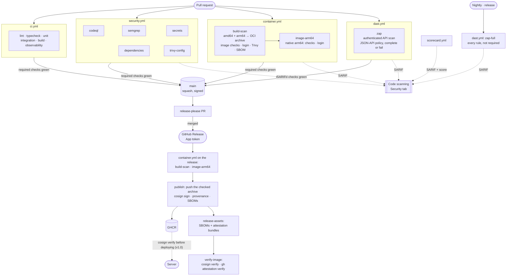

# Security pipeline

How a change becomes a signed release image, what each gate catches, and how anyone can check an image before running it. The decisions behind it are in [ADR-0007](adr/0007-supply-chain-security.md); the threats it answers are in the [threat model](threat-model.md#cicd-and-registry-v04-v10).

## From pull request to verified image



Nothing is published from a pull request or from `main`: they build and check exactly what a release would. The release event comes from the GitHub Release that release-please creates with its App token (ADR-0003); a release created with `GITHUB_TOKEN` would trigger no workflow.

## Gates

| Job (workflow)                  | Tool                                                          | What it catches                                                                                                                                                                 | Blocks the merge on                                      |
| ------------------------------- | ------------------------------------------------------------- | ------------------------------------------------------------------------------------------------------------------------------------------------------------------------------- | -------------------------------------------------------- |
| `codeql` (`security.yml`)       | CodeQL `security-extended`, TypeScript and GitHub Actions     | Injection, path traversal, SSRF, unsafe deserialization, missing authorization patterns; script injection and untrusted checkouts in workflows                                  | a result of security severity 7.0 or more                |
| `semgrep` (`security.yml`)      | Semgrep: OWASP Top 10, Node.js, TypeScript rule packs         | Dangerous APIs and patterns: `eval`, raw SQL, weak crypto, open redirects, unsafe regex                                                                                         | a finding of severity `ERROR`                            |
| `secrets` (`security.yml`)      | Gitleaks over the commits of the change (weekly: all history) | Keys, tokens and passwords committed, even if a later commit removed them                                                                                                       | any finding                                              |
| `dependencies` (`security.yml`) | OSV-Scanner on `pnpm-lock.yaml`; `pnpm audit --prod`          | Known vulnerabilities in direct and transitive dependencies, development ones included                                                                                          | CVSS 7.0 or more (OSV); high or critical (audit)         |
| `trivy-config` (`security.yml`) | Trivy misconfiguration scan                                   | Dockerfile mistakes: root user, unpinned or `latest` bases, secrets in `ENV`, missing health check                                                                              | a HIGH or CRITICAL misconfiguration                      |
| `build-scan` (`container.yml`)  | Buildx, `scripts/image-check.ts`, Trivy, Syft                 | An image that runs as root, has a shell, preloads telemetry where it should not, loads the wrong argon2 binary or cannot log in; OS and npm packages with known vulnerabilities | a failed check; a fixable HIGH or CRITICAL vulnerability |
| `image-arm64` (`container.yml`) | `scripts/image-check.ts` on a native arm64 runner             | The same image checks and a real login on arm64                                                                                                                                 | a failed check                                           |
| `zap` (`dast.yml`)              | OWASP ZAP API scan, as a workspace member                     | What only the running API shows: missing or wrong headers, error leaks, injection and authorization flaws reachable over HTTP                                                   | a High alert; a rule that did not complete; any 5xx      |
| `scorecard` (`scorecard.yml`)   | OpenSSF Scorecard                                             | Weak repository practices: unpinned dependencies, broad token permissions, missing reviews, unsigned releases                                                                   | never: score and SARIF only                              |

Every finding, blocking or not, reaches the **Security** tab as SARIF (ZAP through `scripts/zap-report.ts`, which points each alert at the module that serves its URL). One tool reports each kind of finding: dependency advisories come from OSV-Scanner only, and Trivy covers configuration and the packages inside the images, so an advisory never opens two alerts. Compose files have no Trivy checks; their invariants (ports on `127.0.0.1`, images pinned by digest, the metrics port never published) are unit tests.

The DAST scan seeds an owner's workspace, with a project, a task and a pending invitation, then authenticates as a member who joined it through an invitation link. Path parameters take the seeded ids, so the scan reaches real resources, while deleting the workspace, the project, the owner's task or the owner answers 403: the scan cannot destroy what it scans. The scanner logs in again before its access token expires, and the stack's rate limits are raised so that attacks reach the handlers (see below).

## Required checks

`main` requires, besides `lint`, `typecheck`, `unit`, `integration`, `build`, `conventional-title` and `observability`:

| Check          | Why it is required                                                                               |
| -------------- | ------------------------------------------------------------------------------------------------ |
| `codeql`       | The broadest SAST, and the only one reading the workflows themselves                             |
| `semgrep`      | Fast, rule-based: catches the patterns CodeQL's data-flow queries do not model                   |
| `secrets`      | A pushed secret is compromised the moment it is public; nothing else catches it before the merge |
| `dependencies` | Most of the code that runs is not ours                                                           |
| `trivy-config` | The Dockerfile decides the runtime's privileges                                                  |
| `build-scan`   | The image is what ships: it must run, log in and carry no fixable HIGH or CRITICAL vulnerability |
| `image-arm64`  | Both platforms are published: an arm64 image that cannot load argon2 must not reach a release    |
| `zap`          | The only gate that attacks the running API                                                       |

`scorecard` is not required: it runs on `main` and weekly, never on pull requests, and judges the repository rather than the change. The release jobs (`publish`, `release-assets`, `verify-image`) run on releases only.

No required check filters its trigger by path, which would leave it pending forever on a pull request it skips. `build-scan`, `image-arm64` and `zap` always run and report; on a pull request that changes no source, dependency, image or Compose file, they skip their steps inside the job, as `observability` does. Pushes to `main` and releases always run everything. A check joins the ruleset only after three consecutive passing runs.

### Why `zap` gates every pull request

`zap` is the only gate that sees the running API: security headers, error bodies, the authorization of every route over HTTP, and injection reachable through the real stack. The unit and integration suites check the cases we thought of. The scan probes the ones we did not. Scanning only `main` would find a regression after the merge, when a release pull request may already contain it. So the scan runs before the merge, and it must be both short and complete.

The first version was neither. It ran ZAP's `API-Minimal` policy on one thread with a 120 ms delay, to stay under the API's global rate limit, and took about 11 minutes. It finished 30 seconds short of its 10-minute time box, with nothing to fail it had it been cut. Worse, 92.7 % of its 3,849 requests were answered 400: ZAP could not build valid requests from the OpenAPI document, so its attacks stopped at validation. The scan now works as follows:

| Measure (CI, `zap` job)                     | Before (`API-Minimal`, throttled) | After (`.zap/pr.policy`) |
| ------------------------------------------- | --------------------------------- | ------------------------ |
| Job                                         | 677 s                             | 211 s                    |
| Active scan                                 | 571 s                             | 80 s                     |
| Rules                                       | 21, all complete by 30 seconds    | 12, all complete         |
| Requests                                    | 3,849                             | 4,915                    |
| Answered 400 (attack stopped at validation) | 3,569 (92.7 %)                    | 3,662 (74.5 %)           |
| Answered 2xx (attack reached a handler)     | 58                                | 566                      |
| Answered 401                                | 0                                 | 111 (login and refresh)  |
| Answered 429                                | 0                                 | 0                        |

- **Valid base requests.** The scanner gets a copy of the OpenAPI document with nullable unions collapsed (ZAP wrote them unquoted, so task bodies were not JSON) and a valid `example` for every value ZAP cannot guess: seeded ids, emails, the workspace slug, invitation tokens and cursors ([`scripts/dast-openapi.ts`](../scripts/dast-openapi.ts)). The 400s that remain come from payloads in fields with an enum, a UUID or a format, which is validation doing its job.
- **Raised rate limits, in the DAST stack only.** Once the requests were valid, `register` and `login` answered 289 of them with 429, on the routes most worth attacking. The DAST stack sets `RATE_LIMIT_MULTIPLIER=1000`, so the scan runs without a delay and reaches those handlers. The full scan sends more requests to `register` than a hundredfold limit allows in an hour. Production refuses any value but 1, and the API logs a warning whenever it is raised. The limits themselves are proven at their real values by the integration tests.
- **A policy for this API.** [`.zap/pr.policy`](../.zap/pr.policy) keeps the rules that apply to a JSON API on Node.js and PostgreSQL, adds path traversal and PostgreSQL time-based SQL injection, and leaves the XML, SOAP, PHP, Java and C rules to the full scan.
- **Authenticated for as long as it takes.** A ZAP hook ([`.zap/hooks.py`](../.zap/hooks.py)) logs in as the seeded member and sends the token through a Replacer rule restricted to the API, then logs in again every ten minutes. A failed first login fails the scan.
- **Never cut short.** The pull request scan has a 12-minute budget and needs about a minute and a half. [`scripts/zap-gate.ts`](../scripts/zap-gate.ts) fails the job unless every rule enabled in the policy ran to the end. That covers a rule cut by the budget, a skipped rule, and a rule missing from the ZAP image. The job summary shows each rule's status, time, requests and alerts, and the status codes counted by ZAP and by the API's own log ([`scripts/api-status.ts`](../scripts/api-status.ts)). The `zap-report` artifact keeps the same data as JSON.
- **No server error passes.** The same gate fails the job when the API answers any 5xx during the scan, in ZAP's count of the active scan or in the API's own request log, whatever severity ZAP gives it. A 500 under attack is a bug: ZAP rates it below High, so the High-alert gate alone let one through. That was the NUL character that PostgreSQL rejects in a text field. The gate also fails when the API's log counted no request, so that missing data cannot pass as a clean scan.

`zap-full`, which is not required, runs every installed rule nightly, on each published release and on demand. The one exception is Log4Shell, which needs an out-of-band callback service the CI does not run and targets Java's Log4j. It uses the same stack and gates, a 180-minute budget (a local run of its 52 rules took under 7 minutes and sent 9,936 requests), and its own code scanning category. A High alert it raises is fixed in a follow-up pull request.

The job runs in parallel with the other checks and skips the scan when a pull request changes nothing the API serves (documentation, other workflows and tests only), and a new push cancels the run it supersedes.

## The pipeline's own supply chain

- **Actions** are pinned by full commit SHA, with the version in a comment, and the repository refuses unpinned ones. Composite actions in use pin their own dependencies the same way.
- **Scanners** run as container images pinned by tag and digest in [`.github/scanners/compose.yaml`](../.github/scanners/compose.yaml); no scanner is downloaded as "latest" at run time. Trivy runs from its image, not through `trivy-action`, whose tags were hijacked in March 2026 ([GHSA-69fq-xp46-6x23](https://github.com/aquasecurity/trivy/security/advisories/GHSA-69fq-xp46-6x23)).
- **Dependabot** updates actions, scanner images, base images and npm packages after a three-day cooldown; its pull requests run every gate above. Runs that Dependabot triggers get no Actions secrets and a read-only token unless a job's `permissions` ask for more. No required check uses a secret, and each one that uploads SARIF asks for `security-events: write`. Its pull requests are merged by hand, so the push to `main` that follows runs as the maintainer with the usual permissions.
- **Permissions** are empty at workflow level and granted per job. `packages: write`, `id-token: write` and `attestations: write` exist in the `publish` job only; `contents: write` in `release-assets` only. No job uses `pull_request_target`, and checkouts do not keep credentials.
- **harden-runner** records the network egress of every job (audit mode).

## The image

- `gcr.io/distroless/nodejs24-debian13:nonroot`, pinned by digest: Node.js and glibc, no shell, no package manager, uid 65532, application files owned by root. In Compose the root file system is read-only, capabilities are dropped and `no-new-privileges` is set.
- `linux/amd64` and `linux/arm64`, built on one runner without emulation: the Node.js stages run on the build platform and install production dependencies for the target's CPU and glibc.
- One build per run, into an OCI archive. The checks and scanners read per-platform copies split from it with `--preserve-digests`, so they carry the manifest digests that get published, and a release pushes the archive with `skopeo copy --all --preserve-digests`; the job then compares the digest GHCR serves with the archive's own.
- Tags: `X.Y.Z`, `X.Y` and `latest`. Deploy by digest.

## Verifying an image

Requires [cosign](https://docs.sigstore.dev/cosign/system_config/installation/) 3 and the [GitHub CLI](https://cli.github.com/).

```bash
IMAGE=ghcr.io/caiodassumpcao/secure-api-pipeline
VERSION=0.4.0
REPO=caiodassumpcao/secure-api-pipeline

# Signature: made by container.yml for this release tag, through GitHub's OIDC issuer.
cosign verify "$IMAGE:$VERSION" \
  --certificate-identity "https://github.com/$REPO/.github/workflows/container.yml@refs/tags/v$VERSION" \
  --certificate-oidc-issuer https://token.actions.githubusercontent.com

# SLSA build provenance: built by this repository's workflow, from which commit.
gh attestation verify "oci://$IMAGE:$VERSION" --repo "$REPO" \
  --signer-workflow "$REPO/.github/workflows/container.yml"

# SBOMs (SPDX, one per platform), signed the same way.
gh attestation verify "oci://$IMAGE:$VERSION" --repo "$REPO" \
  --signer-workflow "$REPO/.github/workflows/container.yml" \
  --predicate-type https://spdx.dev/Document/v2.3

# The same SBOMs (SPDX and CycloneDX) and the attestation bundles, from the release.
gh release download "v$VERSION" --repo "$REPO" --pattern '*.json'
```

`cosign verify` fails unless the signature's certificate names exactly this workflow and tag. Resolve the tag to its digest once (`cosign verify` prints it), verify, and run that digest: a tag can move, a digest cannot.

## Exceptions

A finding is ignored only in the scanner's own file, never by dismissing the alert in the Security tab: [`.trivyignore.yaml`](../.trivyignore.yaml), [`osv-scanner.toml`](../osv-scanner.toml), [`.zap/rules.tsv`](../.zap/rules.tsv), the alert filters in [`.zap/hooks.py`](../.zap/hooks.py), an inline `nosemgrep` comment, or a `.gitleaksignore` fingerprint (none so far). Each entry is listed here with its reason, and with an expiry date when it is temporary.

| Tool               | Finding                    | Scope                                                                     | Why it is accepted                                                                                                                                                                                                                                                                                                                                                    | Until |
| ------------------ | -------------------------- | ------------------------------------------------------------------------- | --------------------------------------------------------------------------------------------------------------------------------------------------------------------------------------------------------------------------------------------------------------------------------------------------------------------------------------------------------------------- | ----- |
| ZAP (alert filter) | 10062 PII Disclosure, High | Evidence of exactly 12 digits, downgraded to Informational, not dismissed | The rule reads any Luhn-valid run of digits as a card number. Every error response carries a random UUID (`traceId`), whose last group is 12 hex characters, and those are sometimes 12 digits that pass the check: it failed one CI run of `zap` with `574743675757`. The API stores no card or identity numbers. Card-length matches (13 to 19 digits) still block. | —     |

## Running the scanners locally

The same images as CI, from the repository root:

```bash
SCAN="docker compose -f .github/scanners/compose.yaml --project-directory . run --rm"
mkdir -p reports
$SCAN semgrep semgrep scan --config p/owasp-top-ten --config p/nodejs --config p/typescript --metrics off
$SCAN --user "$(id -u):$(id -g)" gitleaks git --redact --no-banner .
$SCAN osv-scanner scan source --lockfile pnpm-lock.yaml
$SCAN trivy config --ignorefile .trivyignore.yaml .
```
