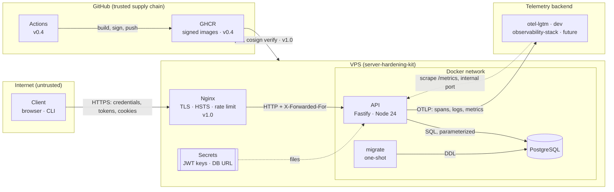

# Threat model

> Status: **v0.4**. Covers the API, its data and its telemetry as built today, plus the delivery chain the roadmap adds (CI/CD in v0.4, deployment in v1.0), whose controls are marked with the version that brings them. Controls are summarized in [DESIGN §5.1](DESIGN.md#51-controls); decisions are in the [ADRs](adr/).

## Data flow and trust boundaries

Trust boundaries: **Internet → Nginx** (everything from the client is hostile input), **Nginx → API** (only the proxies listed in `TRUST_PROXY` may report the client IP), **API → PostgreSQL** (one database role today, see RR-5), **GitHub → VPS** (only images signed by this repository's workflows are deployed, v1.0), **API → telemetry backend** (everything exported is copied to another system and read by other people: no secrets, personal data limited to ids, IPs and user agents; the backend may only scrape `/metrics`).

## Assets

| Asset                                | Why it matters                                      | Where                                            |
| ------------------------------------ | --------------------------------------------------- | ------------------------------------------------ |
| Tenant data (projects, tasks)        | Confidentiality and integrity between workspaces    | PostgreSQL, scoped by `workspace_id` (ADR-0005)  |
| Credentials                          | Account takeover                                    | `users.password_hash` (argon2id)                 |
| Sessions                             | Account takeover without the password               | Refresh-token families (SHA-256 only), cookies   |
| Access-token signing key             | Forging any user's identity                         | Ed25519 private key, Docker secret               |
| Invitation links, device cookies     | Joining a workspace; bypassing the account lockout  | SHA-256 only in the database                     |
| Audit trail                          | Investigating incidents; holds IPs (personal data)  | `audit_events`, append-only, 365 days            |
| Telemetry                            | Diagnosing incidents; reveals usage, holds ids, IPs | Collector (OTLP), `/metrics` on an internal port |
| Release artifacts and CI credentials | Shipping malicious code                             | GHCR, GitHub App key, Actions secrets (v0.4)     |

## STRIDE per component

### API

| Threat                     | Scenario                                                     | Mitigations                                                                                                                                                                                                                                                                                                                     |
| -------------------------- | ------------------------------------------------------------ | ------------------------------------------------------------------------------------------------------------------------------------------------------------------------------------------------------------------------------------------------------------------------------------------------------------------------------- |
| **S**poofing               | Credential stuffing, brute force                             | argon2id; rate limits per IP and per email, shared by instances; lockout after 10 failures for clients without a device cookie (ADR-0009); identical 401 and argon2 cost for unknown, wrong and locked                                                                                                                          |
|                            | Stolen refresh token                                         | Rotation on every use; reuse of an exchanged token revokes the whole session and is audited; 7-day idle and 30-day absolute lifetime; `HttpOnly`, `SameSite=Strict`, `__Secure-` cookie limited to `/v1/auth` (ADR-0004)                                                                                                        |
|                            | Forged or replayed access token                              | Ed25519 signature, algorithm, `typ`, issuer and audience pinned; 15-minute lifetime; the key id selects among the current and previous public keys only                                                                                                                                                                         |
|                            | Forged trace context (`traceparent`)                         | Inbound trace context ignored: a client can neither join its requests to a chosen trace nor force sampling (ADR-0006)                                                                                                                                                                                                           |
|                            | Spoofed client IP to evade limits                            | `X-Forwarded-For` ignored unless `TRUST_PROXY` names the proxy; `true` is refused                                                                                                                                                                                                                                               |
| **T**ampering              | Mass assignment, injection                                   | Strict request schemas; Drizzle with bound parameters only                                                                                                                                                                                                                                                                      |
|                            | Cross-tenant writes (IDOR)                                   | Workspace-scoped repositories, service authorization, composite foreign keys; matrix and cross-tenant suites (ADR-0005)                                                                                                                                                                                                         |
|                            | CSRF on the refresh cookie                                   | `SameSite=Strict`, cookie path, and refresh and logout refuse `Sec-Fetch-Site: cross-site` and foreign `Origin`s                                                                                                                                                                                                                |
| **R**epudiation            | "I did not remove that member"                               | Audit events in the same transaction as the change, with actor, IP and user agent; append-only trigger                                                                                                                                                                                                                          |
| **I**nformation disclosure | Learning whether an email has an account                     | Login answers alike for every failure; invitations look no account up (ADR-0010); registration still discloses it (RR-3)                                                                                                                                                                                                        |
|                            | Learning that another tenant's resource exists               | Non-members get 404, never 403                                                                                                                                                                                                                                                                                                  |
|                            | Secrets in logs, errors or the database                      | Log redaction (headers, cookies, tokens, passwords, query parameters, database errors), tested over full flows; RFC 9457 errors without internals; opaque tokens stored as SHA-256 only                                                                                                                                         |
|                            | Secrets or personal data in telemetry                        | No headers, bodies, query values, SQL parameters or error messages in spans; route templates, not URLs, in span names and metric labels; opaque ids, never emails or names; a redacting exporter; the security suite searches exported spans, logs and metrics, `/metrics` and stdout for the secrets of a full flow (ADR-0006) |
|                            | Scraping `/metrics` from the internet                        | Own HTTP server on `METRICS_PORT`, refused on the public port, never published by Compose nor routed by the proxy                                                                                                                                                                                                               |
|                            | Responses cached by intermediaries                           | `Cache-Control: no-store`                                                                                                                                                                                                                                                                                                       |
| **D**enial of service      | Request floods, expensive hashing                            | 600 requests/min per IP before routing; stricter limits on authentication and invitations; argon2 bounded by the libuv pool; body limit, timeouts, pagination caps                                                                                                                                                              |
|                            | Slow or unreachable telemetry backend                        | Batch exports with bounded queues and timeouts drop data instead of blocking requests; shutdown waits at most 3 seconds; tested with a collector that never answers                                                                                                                                                             |
|                            | Locking a victim out of their account                        | The lockout never applies to a client with a valid device cookie (ADR-0009)                                                                                                                                                                                                                                                     |
| **E**levation of privilege | Admin granting themselves ownership, member managing members | Permission matrix encoded once and tested for every role and action; only owners grant, change or revoke `owner`, invitations included                                                                                                                                                                                          |

### PostgreSQL

| Threat                                    | Mitigations                                                                                                         |
| ----------------------------------------- | ------------------------------------------------------------------------------------------------------------------- |
| Tampering with or erasing the audit trail | A trigger rejects UPDATE, TRUNCATE and DELETE of events younger than 365 days; the owner role can disable it (RR-5) |
| Exposure of the database port             | Compose publishes it on `127.0.0.1` only; the production Compose file does not publish it (v1.0)                    |
| Theft of a backup                         | Only hashes of passwords and tokens; backups encrypted by `drkit` (v1.0)                                            |

### Local telemetry backend (otel-lgtm, development only)

| Threat                                        | Mitigations                                                                                                         |
| --------------------------------------------- | ------------------------------------------------------------------------------------------------------------------- |
| Reading or changing telemetry through Grafana | Anonymous visitors are Grafana admins in this image: Grafana and OTLP/HTTP are published on `127.0.0.1` only (RR-8) |
| Telemetry kept beyond its use                 | No volume: data lives in the container and is removed with it                                                       |

### Nginx and the host (v1.0)

| Threat                   | Mitigations                                                                                                      |
| ------------------------ | ---------------------------------------------------------------------------------------------------------------- |
| Downgrade, eavesdropping | TLS only, HSTS                                                                                                   |
| Floods                   | `limit_req` in front of the API's own limits                                                                     |
| Host compromise          | `server-hardening-kit`; API container read-only, non-root, no capabilities, `no-new-privileges`, resource limits |

### CI/CD and registry (v0.4, v1.0)

The pipeline is described in [security-pipeline.md](security-pipeline.md) (ADR-0007).

| Threat                                      | Mitigations                                                                                                                                                                                                                            |
| ------------------------------------------- | -------------------------------------------------------------------------------------------------------------------------------------------------------------------------------------------------------------------------------------- |
| Malicious or vulnerable dependency          | Lockfile, 3-day release age, no install scripts unless approved, overrides for vulnerable transitive versions, Dependabot; OSV-Scanner and `pnpm audit` block CVSS ≥ 7 on every pull request                                           |
| Vulnerable code merged                      | CodeQL and Semgrep on every pull request, blocking high-severity findings; OWASP ZAP against the running API, blocking High alerts                                                                                                     |
| Secret committed                            | Gitleaks before each commit (hook) and on every pull request; GitHub secret scanning with push protection                                                                                                                              |
| Tampered workflow, action or scanner        | Actions pinned by SHA (enforced by the repository), scanner images pinned by digest, 3-day Dependabot cooldown, CodeQL on the workflows, harden-runner egress audit; no `pull_request_target`, checkouts without persisted credentials |
| Overprivileged pipeline token               | Empty workflow permissions, granted per job; package, OIDC and attestation writes in the release `publish` job only                                                                                                                    |
| Leaked release credentials                  | Release PRs use a short-lived GitHub App token limited to three permissions (ADR-0003); images are signed keyless, so there is no signing key to leak                                                                                  |
| Published image differs from the tested one | One build per run; checks and scanners read its OCI archive, which a release pushes with preserved digests, then compares the served digest                                                                                            |
| Tampered or substituted image               | cosign keyless signature bound to the workflow and release tag, SLSA provenance and SBOM attestations (v0.4), verified before deploying (v1.0)                                                                                         |
| Vulnerable base image or OS package         | Distroless base without shell or package manager, pinned by digest and updated by Dependabot; Trivy blocks fixable HIGH and CRITICAL vulnerabilities in both images                                                                    |
| Change merged without a second reviewer     | Required checks, signed commits and no bypass, but no second person: RR-9                                                                                                                                                              |

## Personal data and retention

The audit trail stores the client **IP address** and **user agent** of each event, which are personal data, besides actor and target ids. Events are kept **365 days**, then deleted by the hourly cleanup job: long enough to investigate an incident discovered late, and above the six months the Brazilian Marco Civil da Internet (art. 15) requires for application access records, while staying bounded as data minimization asks (LGPD art. 6). The database enforces it: the append-only trigger only lets rows older than 365 days be deleted. Only owners and admins of a workspace read its events; authentication events, which have no workspace, are not exposed by the API. Failed logins for unknown accounts record no email address.

**Telemetry** also holds personal data in the sense of the LGPD (art. 5, I): spans carry the opaque **user and workspace ids** of each authenticated request, the client **IP address** and the **user agent** (HTTP semantic conventions), and log lines carry the user id. Emails, names, credentials and request bodies are never recorded (ADR-0006). Traces exist to diagnose recent behavior, so they are kept briefly:

- **Local** (`otel-lgtm`): data lives inside the container, without a volume, and is deleted by `docker compose down`.
- **`observability-stack`** (expected): **14 days** for traces and logs, enforced by Tempo and Loki retention; metrics hold no personal data (route templates, status codes, failure reasons) and may be kept longer.

Other personal data: the email and name of each account. Device cookies, sessions, invitations and rate-limit counters are deleted when they expire; rate-limit keys are hashes, never addresses or emails.

## Residual risks

| ID   | Risk                                                | Status                                 | Revisit |
| ---- | --------------------------------------------------- | -------------------------------------- | ------- |
| RR-1 | Account enumeration through member addition         | **Resolved in v0.2** (ADR-0010)        | —       |
| RR-2 | Test identity stub trusts a request header          | **Resolved in v0.2** (stub removed)    | —       |
| RR-3 | Registration discloses that an email has an account | Accepted                               | —       |
| RR-4 | Email addresses are not verified                    | Accepted (no email delivery, non-goal) | Future  |
| RR-5 | One database role: the API owns its tables          | Accepted until v1.0                    | v1.0    |
| RR-6 | Access tokens outlive logout by up to 15 minutes    | Accepted (ADR-0004)                    | —       |
| RR-7 | The global per-IP limit is per instance             | Accepted                               | v1.0    |
| RR-8 | Local Grafana admits anonymous admins               | Accepted (development only)            | —       |
| RR-9 | No second person reviews changes                    | Accepted (single maintainer)           | —       |

### RR-1. Account enumeration through member addition — resolved

Adding a member by email answered 404 for an address without an account, and added an existing account without its consent. v0.2 replaces it with invitation links (ADR-0010): creating an invitation looks no account up, and the invitee must accept it while logged in. Removing `POST /members` is a breaking change of v0.2.

### RR-2. Test identity stub — resolved

The `x-test-user-id` stub of v0.1 is deleted; every environment authenticates with access tokens, and the test suites use real tokens.

### RR-3. Registration discloses existing accounts

`POST /v1/auth/register` answers 409 when the address is taken. A uniform answer needs an email to the address owner, which the API cannot send. Mitigations: the password is hashed before the check, so the timing is the same, and registrations are limited to 5 per hour and IP.

### RR-4. Unverified email addresses

Anyone can register any address. The consequences are limited: invitations do not trust the address alone (the link is the proof, ADR-0010), and no feature sends email. Email verification belongs with an email-delivery service, out of scope for v1.

### RR-5. Database roles (Phase 5)

The API and the migrations use the same PostgreSQL role, which owns the tables: a compromised API process could disable the audit trigger, then alter or delete events. **Planned for Phase 5** (DESIGN §13): a migration role that owns the schema, and a runtime role with only what the API needs, without `UPDATE` or `DELETE` on `audit_events`; the cleanup job then deletes expired events through a dedicated role or a `SECURITY DEFINER` function limited to them.

### RR-6. Access tokens after logout

Logout revokes the session, so no new access token can be obtained, but tokens already issued stay valid until they expire, at most 15 minutes later. A deny list would make every request depend on shared state; the short lifetime is the accepted trade-off (ADR-0004).

### RR-7. Per-instance global limit

The coarse limit of 600 requests per minute lives in each instance's memory, so N instances allow N times as much. The limits that matter for security (authentication, invitations) are shared through PostgreSQL, and Nginx adds its own limit in v1.0.

### RR-8. Anonymous admins in the local Grafana

The `grafana/otel-lgtm` image lets anonymous visitors in as admins, which suits a disposable development stack. The observability profile publishes Grafana and OTLP/HTTP on `127.0.0.1` only, keeps no volume, and is never deployed; production telemetry goes to `observability-stack`, with its own authentication.

### RR-9. Single maintainer, no second reviewer

The repository has one maintainer, so no pull request is approved by someone other than its author, and OpenSSF Scorecard scores Code-Review and Branch-Protection accordingly. A required approval would only block every merge. What a reviewer would catch is covered, partly, by the required checks (tests, SAST, secrets, dependencies, configuration, image and DAST scans), signed commits and a `main` without bypass; what only a human would notice is not. A second maintainer, or a reviewer from the ecosystem projects, would require one approval.
